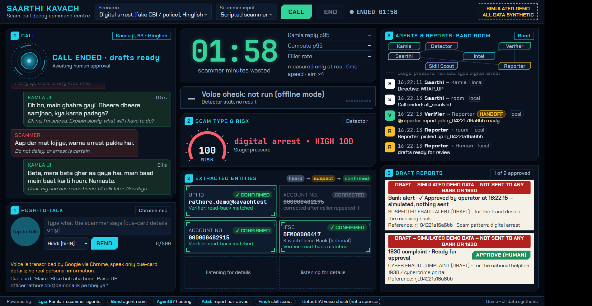

# Saarthi Kavach

**Kamla ji picks up the scam call, so you don't.**

A team of AI agents answers a simulated scam call as "Kamla ji", a fictional 68-year-old Hinglish speaker. She keeps the scammer talking while the agents pull out his payment trail and write two draft reports. A human approves. Nothing is ever sent.

**Who runs it, and who it is for.** The dashboard is an operator console, not a citizen app. It is built for the people who receive scam reports: bank fraud desks, 1930 / I4C cyber-crime cells, and telecom anti-fraud teams. They run the decoy, review the extracted payment trail and approve the drafts. **What a citizen gets:** a plain warning card ("Yeh fraud hai: paise mat bhejo, call kaato, 1930 par call karo" / "Do not pay. Hang up. Call 1930.") and a case-id-linked draft complaint that the complainant completes (UTR, amount, debit time). Caveat from our synthetic panel (directional only, not demand evidence): whether a bank desk or 1930 intake would act on an AI-drafted, human-approved report with no victim attached is our riskiest untested assumption.

Context (not our result): Indians lost Rs 22,845.7 crore to cyber fraud in 2024 (reported to Parliament, via Scroll, 23 Jul 2025). 1,23,672 digital-arrest cases were reported in 2024 (Rajya Sabha reply, 12 Mar 2025, via PTI/The Week). **We do not claim any loss prevented.** What we measure is simulated: scammer time engaged in a simulated call and payment identifiers verified. The dashboard shows "This session (simulated): N calls · X min scammer time engaged · Y identifiers verified · Z drafts", and the Verifier chip reads "Read-back matched (synthetic demo value)". The citizen flow is a start page (`/start.html`) leading to a Hindi-first citizen page (`/citizen.html`) with the warning card, a tap-to-call 1930 button, a WhatsApp share button and the I4C (MHA) advisory of 6 Mar 2025 cited.

| | |
|---|---|
| Demo URL | `<DEMO_URL>` (passcode: `<DEMO_PASSCODE>`) |
| Demo video | `https://drive.google.com/file/d/1QbWHWrcm4nxQcX4-Y_pVCWxif1bRJY6L/view?usp=sharing` (3:42, auto-built from a real live run with real call audio; see `docs/VIDEO.md`) |
| Repo | `https://github.com/SaketSinghRajput/Saarthi-Kavach` |

> Fully simulated. No real phone network, no real scammers, no real people or numbers. All data is synthetic.



## How it works (60 seconds)

Hackathon track: a **Voice Agent** handles speech and intent; **Action Agents** complete tasks such as lookups.

Which parts are LLMs and which are plain code (we say it straight):

| Kind | Agent | What it is |
|---|---|---|
| LLM agent | **Kamla ji** (Voice Agent) | Live Lyzr agent. Kokoro text to speech gives her a voice. She stalls, asks the caller to repeat, and reads back every value he gives. |
| LLM agent | **Scammer** | Lyzr agent in local live mode. **Hosted builds run the scripted scammer only** (no live LLM scammer on a public URL). |
| LLM agent | **Reporter narrative** | AdaL writes the 4-6 sentence narrative, off the call path. The draft structure itself is code. |
| Deterministic action agent | **Detector** | Rules score each scammer turn for scam type, stage and risk (under 10 ms). |
| Deterministic action agent | **Intel** | Pulls UPI IDs, bank accounts, IFSC codes and phone numbers from the speech. |
| Deterministic action agent | **Verifier** (read-back) | Checks format and, in demo mode, that each value is a planted fixture value. Unverified values never reach a draft. |
| Deterministic action agent | **Finch Scout** | Looks up catalogue skills for the scam type on Finch (read-only, discovery only). |
| Coordination | **Band** | Shared room for the one handoff: `@reporter report job rj_<12hex> ready`. Job id only, no transcript text. |
| Human | **Approver** | Approves or rejects each draft. "Approve" only flips a status. Nothing is sent. |

```
 Scammer (Lyzr) <--speech/text--> Kamla ji (Lyzr + Kokoro TTS)      <- Voice Agent
        |                              ^ directive (Steering)
        v                              |
   Detector -> Intel -> Verifier ------+
                          |
                          | Band: "@reporter report job rj_... ready"
                          v
                      Reporter --(async)--> AdaL narrative
                          |       Scout --> Finch catalogue (read-only)
                          v
              2 DRAFTS -> human approves   (nothing is sent)
 Whole service: one Docker image (Agent37-ready; live demo host: see Sponsors)
```

Details: `docs/architecture/ARCHITECTURE.md`, event contract `docs/architecture/EVENTS.md`.

## Sponsors

Four are live; Agent37 is packaged but not deployed (below). Full notes: `docs/SPONSORS.md`.

| Sponsor | What it does here | Live evidence | Fallback if it fails |
|---|---|---|---|
| **Lyzr** | 3 live agents (gpt-4o-mini) for the Kamla ji decoy and the Scammer | Contract parses. Lyzr reply p95 varied from 2.9 s to 9.9 s across live runs on 2026-11-22/23. Kamla times out at 6 s to a canned line, and a cached elderly filler ("Haan beta… ek minute") covers the wait: measured dead air p95 1.2-1.3 s against a 1.5 s budget, filler rate 15-54%. | Canned Kamla lines, scripted scammer beats |
| **Band** | Shared agent room, 6 agent identities, one job-id handoff | **Live, and Band drives the Reporter (2026-11-23; listener `4080c8b`, post shape `d42825e`).** In a real live call (scripted scammer, live Lyzr Kamla, Kokoro voice, Finch live, AdaL) the Verifier posted the handoff to Band; the Reporter, polling the room with its own Band key, woke from the stored mention and produced both drafts with `trigger=band_mention`. Band message id `a317c0ce-13cd-4821-b576-6d27e3833955`. | `band` events carry `mirrored:true/false` honestly; if no mention arrives within `REPORTER_FALLBACK_S` the Reporter wakes in-process (`trigger=direct_fallback`) |
| **AdaL** | Writes the 4-6 sentence report narrative via the CLI | Live: ~23 s per narrative, tools disabled, egress allow-list proxy, no identifiers leaked in the output | Template narrative (`adal_unavailable` event) |
| **Finch** | Read-only catalogue scout (`/api/market/search`), keywords tried in order, 4 s budget | Live: keyword "scam" returned 13 skills. Role is `discovery_only`. We never claim it executes or buys anything. | Dated real snapshot |
| **Agent37** | Intended host: whole service as one Docker image (322 MB, non-root) | **Not deployed.** Agent37-ready image and one-command deploy script built and verified locally (offline boot with `docker run --network none`). Our cards were all declined at Agent37's Stripe gate and no card-free tier exists. See `docs/PROBLEMS.md` #13. | Hugging Face Docker Space for the demo URL (`deploy/hf-space/README.md`); or run locally with uvicorn |

DetectifAI supplies a voice-deepfake flag. It is not a sponsor and is not part of the claims above.

## Quick start (offline, no keys)

Needs Python 3.12.

```
py -3.12 -m pip install -r requirements.txt
py -3.12 -m uvicorn app.main:app --host 127.0.0.1
```

Open `http://127.0.0.1:8000/dashboard.html`.

- `?mock=1` replays a scripted call in the browser (`&speed=4` to fast-forward, `&autostart=0` to wait for the Call button).
- `?theme=classic` shows the original dashboard. The default is the Jarvis theme.
- If `APP_PASSCODE` is unset, a dev passcode prints at server start. Starting a call, approving a draft and the kill switch need it.

Checks:

```
py -3.12 -m pytest            # 195 tests, no network, no keys
py -3.12 tools/run10.py       # 10 offline runs
```

Real-world sandbox (optional; needs Docker and local data you supply, see `real-test/README.md`): `bash real-test/run_sandbox.sh`. The data is gitignored and not shipped.

## Live mode (sponsor keys)

Copy `.env.example` to `.env` and fill in only what you have. A missing key falls back to the offline stub, never a crash. `.env` is gitignored. Then run `py -3.12 tools/preflight.py` to check keys and spikes (Lyzr latency check runs only with `--online`).

| Variable(s) | Purpose |
|---|---|
| `INPUT_MODE`, `APP_MODE`, `PACING_SPEED` | Run mode (`scripted` or `ptt`; `semi` offline beats or `live`), speed multiplier (`0` = no waits) |
| `APP_PASSCODE`, `INTERNAL_TOKEN` | Access control |
| `KILL_SWITCH`, `MAX_TURNS`, `MAX_CALL_SECONDS`, `START_RATE_PER_MIN`, `PTT_IDLE_S` | Cost and loop limits |
| `LYZR_API_KEY`, `LYZR_USER_ID`, `LYZR_AGENT_*`, `LYZR_TURN_BUDGET_S`, `KAMLA_TIMEOUT_S` | Lyzr |
| `TTS_PROVIDER`, `TTS_VOICE_KAMLA`, `TTS_VOICE_SCAMMER` | Text to speech (catalog voices only) |
| `BAND_ENABLED`, `BAND_ROOM_ID`, `BAND_KEY_*`, `REPORTER_FALLBACK_S` | Band room and per-agent identities |
| `ADAL_ENABLED`, `ADAL_BIN`, `ADAL_MODEL`, `ADAL_ALLOWED_HOST` | AdaL (refused unless an allowed host is set) |
| `FINCH_ENABLED`, `FINCH_SEARCH_URL` | Finch scout |
| `AGENT37_API_KEY` | Deploy script only. See `deploy/DEPLOY.md` |

## Results

| Check | Result | Command / source |
|---|---|---|
| **Held-out v3** (n=36 new, unseen: 22 scam, 14 benign; protocol pre-registered; frozen detector `ae5f971`, evaluated once): scam-type accuracy | **21/22 = 95.5%** (Wilson 95% 78.2-99.2) | `docs/review/eval-heldout-v3.md` |
| v3 alert (risk >= 0.6): recall | **20/22 = 90.9%** (72.2-97.5) | same |
| v3 alert: precision | **20/20 = 100%** (83.9-100) | same |
| v3 benign alert false positives | **0/14 = 0%** (0-21.5) | same |
| v3 any-type-flag false positives (benign typed as a scam, no alert) | 2/14 = 14.3% (4.0-39.9) | same |
| History, v2 (n=36) before tuning, frozen detector, evaluated once: scam-type 19/22 = 86.4%, alert recall 14/22 = 63.6%, precision 14/15, benign FP 1/14 | v2 then became the DEV set we tuned on; its post-tuning 22/22 is a training figure, not generalisation | `docs/review/eval-heldout-v2.md`, `docs/review/eval-heldout-v3.md` |
| History, v1 held-out (8 items), scam-type accuracy | 5/8; benign false positives 0/8 | `real-test/` sandbox |
| History, v1 tuned set (16 items) | 13/16 (81%); we fixed rules against part of this set, so it flatters us | `real-test/` sandbox |
| Test suite | 195 tests | `py -3.12 -m pytest` |
| Offline extraction runs | 10/10 | `py -3.12 tools/run10.py` |
| Live verification | 5 live calls across all 3 scenarios (digital arrest, fake KYC, fake investment); the Reporter was woken by Band (`trigger=band_mention`) in each of the last 4. Run logs plus `tools/runlog_report.py` reproduce the HUD numbers exactly. | `tools/runlog_report.py` |
| Review panels | Synthetic customer panel rounds 1 to 4 and simulated-investor rounds 2 to 4 (directional only, not demand evidence) | run internally, reports not shipped |
| Band-driven Reporter, live call | `trigger=band_mention`, Band message id `a317c0ce-13cd-4821-b576-6d27e3833955` | live run 2026-11-23; run log and recording kept locally, not shipped |
| Dead air (silence before Kamla's first sound) | p95 1.20-1.21 s, budget 1.5 s (across the last live calls) | live runs 2026-11-23 |
| Kamla answer latency | Lyzr reply p95 varies run to run, 4.2-6.8 s in the latest live calls (2.9-9.9 s across all runs). Kokoro voice warm-up fixed a 6 s first-turn cold start. | live runs; HUD shows LLM and voice split |
| AdaL narrative time | ~23 s, async | live run |
| Spend | ~$10 of a $20 cap | internal spend log, not shipped |

**How the detector was evaluated.** v1 (16 items, tuned) led to v2 (n=36). v2 was evaluated once with a frozen detector (alert recall 14/22), then became the DEV set we tuned on. v3 (n=36, new, unseen) was pre-registered before collection, the detector was frozen at commit `ae5f971`, and v3 was evaluated once. v3 is now consumed; any further tuning needs a fresh v4. The pre-registered success criterion (precision at least 90%, recall above 63.6%) was met.

**Read the v3 numbers with these caveats** (full list in `docs/review/eval-heldout-v3.md`). Scam items are press paraphrases of what a caller said, not ASR speech, so this tests the lexicon on reported narratives, not live speech recognition. v2 and v3 were drawn the same news-heavy way, so the lexicon may have fitted that register. Benign items are written advisories, help texts and news, not recorded genuine calls. It is one labeller per item and n=22 / 14, so the intervals are wide (the upper bound on benign alert false positives is about 21%). The advisory guard (it suppresses awareness phrasing such as "never share your OTP") could miss a real scammer who recites such a line in a live call. Not a production accuracy claim. The v1 sets are kept as history and are not pooled. The offline p95 (1.7 s) is the stub's simulated delay and is not Lyzr latency.

## Voice IDs

Kokoro, run locally (Apache-2.0). Catalog voices only. No cloning, no uploaded samples, no voice design.

| Role | Kokoro voice ID |
|---|---|
| Kamla ji | `hf_beta` |
| Scammer | `hm_psi` |

Allow-list: `KOKORO_VOICES` in `app/integrations/tts.py`. 112 demo lines are pre-rendered to `audio/cache`. A banner in the dashboard states the voices are AI-generated.

## Safety

Safety comes from code, not prompts. A fully prompt-injected model still cannot send a report, because the code gives it no way to.

- **Simulated calls only.** No telephony, no real numbers, no real people.
- **Drafts need human approval and are never sent.** No outbound channel exists (no email, SMS, webhook). Each draft carries the watermark "DRAFT - SIMULATED DEMO DATA - NOT SENT TO ANY BANK OR 1930". Approvals are hashed.
- **Synthetic identifiers.** Persona and scammer details come from one fixture in obviously fake formats. Phone numbers carry "(synthetic)". Real-looking numbers, PINs and OTPs are redacted from Kamla's replies.
- **Transcripts are data.** Scammer speech is wrapped as untrusted, capped at 500 characters, rendered as text.
- **Deterministic Verifier.** Only planted, well-formed values reach a draft. The Band handoff carries a job id only.
- **Access and cost.** Passcode on writes and reads, rate limit, turn and time caps, kill switch.
- **Egress allow-list.** One HTTP client reaches only sponsor hosts. AdaL runs in an empty temp directory, tools disabled, behind a CONNECT proxy that allows one host.
- **Real-test data** is redacted public text, runs in Docker `--network none`, is gitignored, and is never used in the demo.

Gate check: `docs/security/gate-check-2026-11-22.md`. Threat model: `docs/security/threat-model.md`.

## Honest limitations

- **Band fallback.** Band drives the Reporter in live calls (`trigger=band_mention`). Without `BAND_ROOM_ID` and `BAND_KEY_*`, or if no mention arrives within `REPORTER_FALLBACK_S`, the Reporter wakes in-process (`trigger=direct_fallback`) and events show `mirrored:false`.
- **Impact is simulated.** We report engaged time and verified identifiers in simulated calls. No loss prevented is claimed.
- **Agent37 is not deployed.** Cards declined at Agent37's Stripe gate; no card-free tier. The image and deploy script are ready. The public demo URL is planned on a Hugging Face Docker Space.
- **Hosted build uses the scripted scammer only.** No live LLM scammer on a public URL.
- **Lyzr latency is above a voice-grade budget and varies.** Reply p95 ranged 2.9-9.9 s across live runs (Lyzr-side overhead; no model change fixed it). A 6 s timeout falls back to a canned line, and cached filler lines keep dead air at about 1.2 s, but on slow days a third or more of Kamla's turns start with a filler.
- **AdaL takes ~23 s.** It runs async. The template draft shows first.
- **Finch is discovery only.** It never changes the call and never executes a skill.
- **Hosted image has no Kokoro engine.** It plays the 112 pre-rendered clips only. New text gets no audio there.
- **Hosted image has no AdaL CLI.** Hosted drafts use the template narrative.
- **Voice input is typed push-to-talk.** The voice waiver was not approved.
- **Detector numbers are a small sample** (v3 n=36, press paraphrases not ASR speech, same news-heavy register as v2, wide intervals, single labeller; recall 90.9% with a lower bound of 72.2%). The advisory guard could miss a scammer reciting "never share your OTP".
- **Laptop sleep stalls a live call.** An OS network suspend stalled one turn for 59 s and the fallback line played. Keep the machine awake during any live demo.
- **No buyer yet.** No pilot proposal or outreach has been sent. Whether a desk accepts our drafts without re-keying is untested.
- Out of scope: real phone network, real scammers, sending reports, bank integrations, languages beyond Hindi-English, voice cloning.

## Team and credits

**Team Falcon** — Saket Singh Rajput (founder, lead) and team.

Built with Lyzr, Band, AdaL and Finch; packaged for Agent37 (not deployed there). Kokoro TTS (Apache-2.0). Voice flag by DetectifAI (not a sponsor). Licence: `MIT (see LICENSE)`.

## Public mirror

This repository is a **redacted public mirror** of a private repo, prepared for hackathon submission
(security gate G8). It holds the project only: source, tests, deploy files, key docs and product
screenshots. It runs fully offline. To avoid publishing anything that could help a real scammer or
expose private material, the following are withheld:

- `prompts/` (persona and caller prompts): replaced by neutral placeholders, see `prompts/README.md`.
- The persuasive scam beats of the private fixture: `fixtures/synthetic.sample.json` has the same
  schema, planted synthetic IDs, glosses, lexicon, IFSC table and fillers, but generic one-line outlines
  of each scam tactic. The app and tests use the sample when the private fixture is absent.
- `.env*` (only `.env.example` is kept), `data/`, the real-world sandbox data, an internal document (not shipped), `models/`,
  `audio/` (synthetic TTS clips; regenerate with the Kokoro engine, `app/integrations/tts.py`), and
  internal planning, review and status material.

Tests that need the full scam beats are skipped with a reason. The git history is a single fresh commit.
